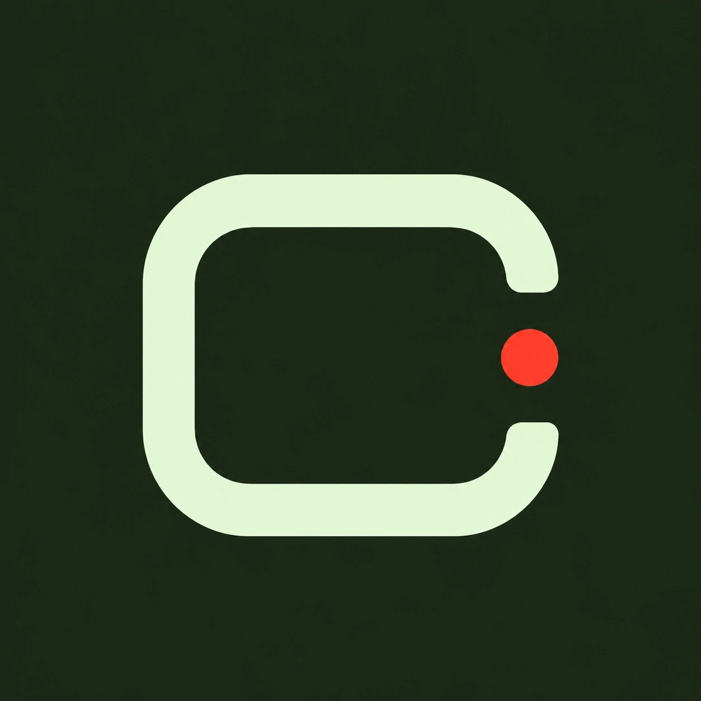
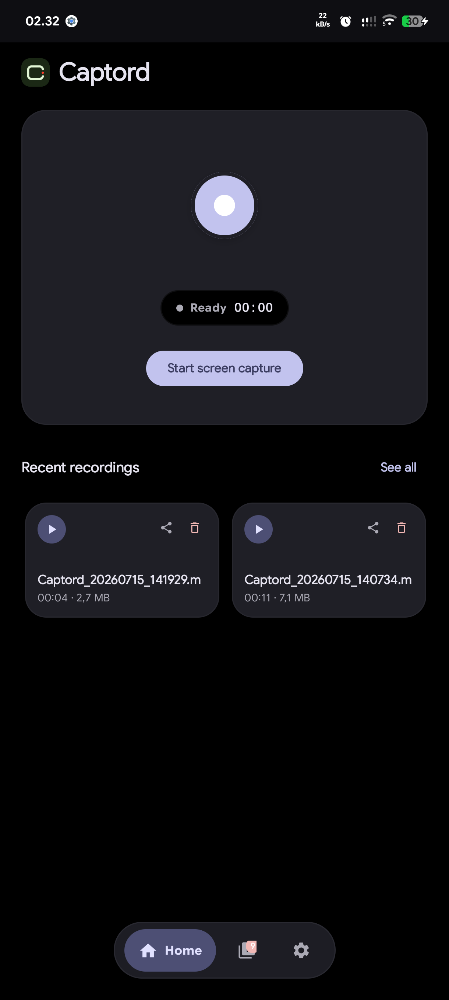
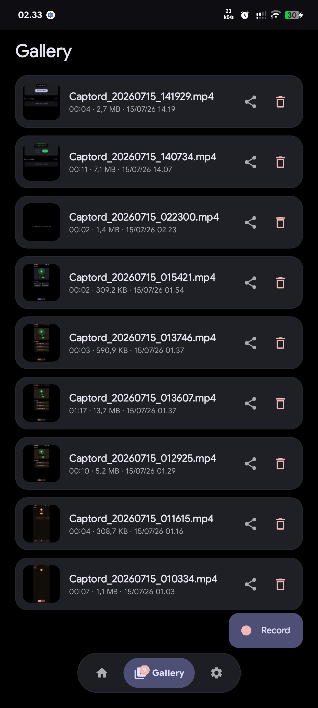
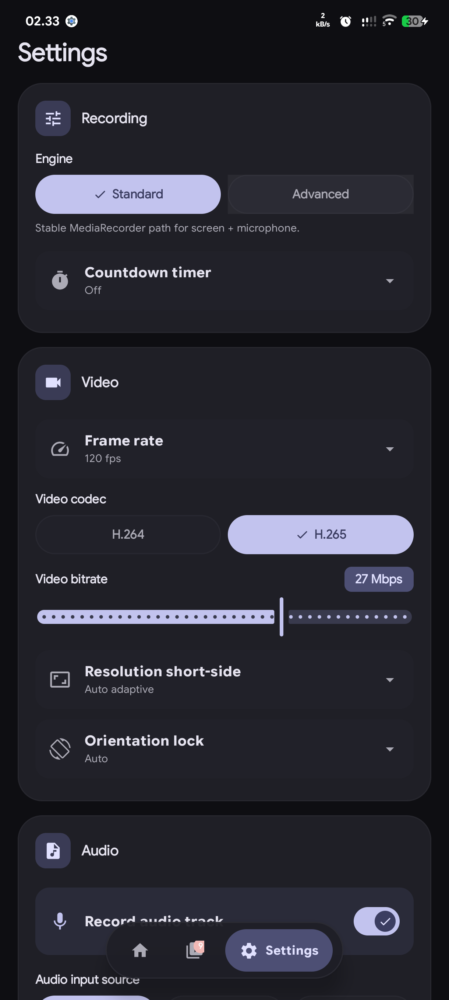
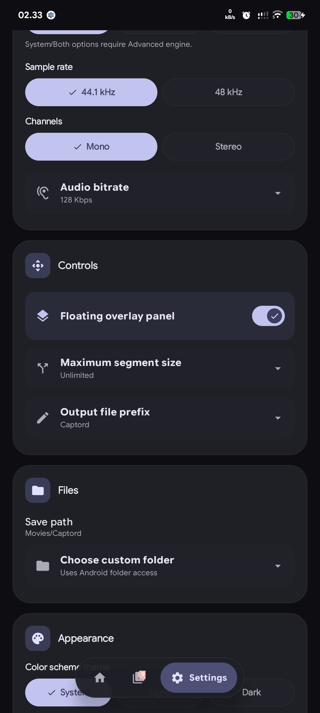

<div align="center">



# Captord

Android screen recorder for local `.mp4` capture.

Pure Kotlin · Jetpack Compose · Material You · local `.mp4` · no cloud

[Features](#features) · [Screenshots](#screenshots) · [Build](#build) · [Permissions](#permissions) · [License](#license)

</div>

---

Captord is an Android-only screen recorder built with Kotlin and Jetpack Compose. A foreground service owns the recording session and timer, so a recording can continue while the app is backgrounded.

Recordings are stored locally in `Movies/Captord` or a folder selected through Android's Storage Access Framework. Captord has no accounts, cloud sync, or analytics upload.

---

## Screenshots

<div align="center">
  
  
  
  
</div>

| | |
|--|--|
| **Home** | Record control, current state, and recent clips |
| **Gallery** | Local recordings with preview, sharing, and deletion |
| **Settings** | Recording engine, video, audio, controls, and appearance |

---

## Design

| Principle | Implementation |
|-----------|-----------------|
| **Focused recording UI** | Start capture from Home; recording options remain in Settings. |
| **Service-managed session** | The foreground service owns state and timing; the UI observes `Flow` and `StateFlow`. |
| **Two recording engines** | Standard uses `MediaRecorder` for microphone capture. Advanced uses `MediaCodec` and `MediaMuxer` for high frame rates, internal audio, and file splitting. |
| **Local output** | Output remains in a hidden pending directory until finalization succeeds, then appears in the gallery. |

---

## Features

- Record, pause, resume, and stop `.mp4` screen recordings
- Standard (`MediaRecorder`) and Advanced (`MediaCodec` + `MediaMuxer`) engines
- Microphone audio; internal/system audio and mixed audio on API 29+ with the Advanced engine
- H.264 or H.265, 2-40 Mbps bitrate, configurable frame rate and short-side resolution
- Foreground notification, floating overlay, Quick Settings tile, and launcher shortcuts
- Start countdown and automatic segment split by file size
- Gallery with Media3 preview, sharing, and deletion
- Dynamic color on API 31+ and light/dark/system theme options
- Screen-off pause, a bounded wake lock, and locked recording settings during a session
- Local files only; no account or cloud upload

---

## How it works

```text
Compose UI  →  RecordingRepository  →  ScreenRecorderService  →  Engine  →  .pending  →  Movies/Captord
```

---

## Permissions

| Permission / consent | Why |
|----------------------|-----|
| **MediaProjection** | Capture the screen; Android shows a consent dialog for each session |
| `RECORD_AUDIO` | Microphone and mixed-audio recordings |
| `FOREGROUND_SERVICE` with mediaProjection / microphone types | Keep an active recording running with a visible notification |
| `POST_NOTIFICATIONS` (API 33+) | Show recording + “saved” notifications |
| `SYSTEM_ALERT_WINDOW` | Optional floating control overlay |
| `READ_MEDIA_VIDEO` (API 33+) | Browse video files in the gallery |

Captord does **not** require camera, location, or full storage manager access for the default path.

---

## Build

```bash
# from Captord/
./gradlew :app:installDebug
```

| | |
|--|--|
| Min SDK | **29** |
| Target SDK | **36** |
| Package | `com.captord.screenrecorder` |

```bash
./gradlew :app:testDebugUnitTest
./gradlew :app:assembleDebug
# release (signing must be configured)
./gradlew :app:assembleRelease
```

Use a physical device to verify MediaProjection: start a recording, stop it, and confirm that the resulting file plays.

---

## First recording

1. Install and open Captord.
2. Grant audio and notification permissions when prompted.
3. Tap **Start screen capture** and approve Android's capture dialog.
4. Stop from the app, notification, overlay, or Quick Settings tile.
5. Open **Gallery** or browse **`/sdcard/Movies/Captord`**.

---

<details>
<summary><strong>Project layout</strong></summary>

```text
Captord/
  app/src/main/java/com/captord/screenrecorder/
    ui/                 # Compose screens + theme
    feature/recorder/   # Repository, ViewModel, models
    core/engine/        # Standard + Advanced engines
    core/service/       # FGS, notifications, QS tile
    core/audio/         # MIC / internal / mix
    core/storage/       # Pending → final output
    core/gallery/       # List, share, delete
  assets/readme/        # README screenshots & diagrams
```

</details>

---

## License

[MIT](./LICENSE) © Captord contributors

---
